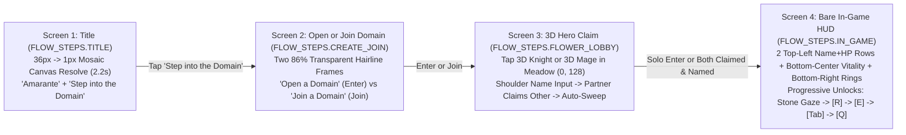

# *Amarante* - Exhaustive UI/UX & Character Mechanics Behavioral Specification

**Date:** 2026-11-05  
**Target Worktree:** `C:\Users\silen\projects\kilo-3d-kit\.kilo\worktrees\behavior-ui`  
**Target Hardware Profiles:**
- **Desktop (`desktop`):** `i5-12400F` + `RX 6700` (`1600×900` / `1080p` 144Hz, `DPR = 2.0`, `PointerLock` mouse-look + keyboard keycap rings)
- **Tablet (`tablet`):** `Xiaomi Pad 7` (`3200×2136` `3:2` 144Hz, `DPR = 1.5`, left floating thumbstick + right touch-orbit + ergonomic thumb-arc rings)

> **Design Read (`frontend-design` & `interfaces`):**  
> *Reading this as: a romantic 2-player co-op action RPG HUD and opening flow for Vikas (Desktop) and Ishika (Xiaomi Pad 7), using a Transparent Open-Air Linework & Genshin-Style See-Through Circular Ring language (`82%+` transparent, `0px` blur, `1.5px` double-ring hairlines) with Environment-Adaptive Ink Polarity that breathes with the live 3D wildflowers, grass, and sky.*
>
> **Three Dials Configuration:** `DESIGN_VARIANCE: 6` · `MOTION_INTENSITY: 6` · `VISUAL_DENSITY: 2` (Airy open-air HUD where the 3D world is the material).
>
> **Zero-Spoiler Rule:** This specification intentionally omits the God of Love's secret true name and the verbatim verse/answers of the 3 Sacred Inscription Stone poems so Vikas can experience the adventure blind alongside Ishika.

---

## 1. Visual System: Transparent Open-Air Linework & Environment-Adaptive Ink Polarity

### 1.1 Hard Visual Bans (What We Are Replacing and Why)

| Banned Pattern | Previous Slop in `app-flow.js` / `sculpted-hud.js` | Mandatory Replacement |
|---|---|---|
| **No Glassmorphism (`backdrop-filter: blur`)** | `#af-pixel-veil`, `.af-silk-card`, `.af-char-claim-crest`, `.sh-joy-ring`, `.sh-modal-backdrop` used `backdrop-filter: blur(5px..14px)` which turns the 3D flower meadow into muddy frosted milk. | **`backdrop-filter: none` everywhere.** All UI containers are `82%+` transparent (`background-color` alpha `<= 0.18`) so individual 3D wildflower petals, grass blades, and cobblestones remain razor-sharp behind every control. |
| **No Opaque Beige / Brass / Limestone Slabs** | `.sh-hp-slab`, `.sh-round-stone-btn`, `.sh-power-stone-frame`, `#sculpted-commune-btn`, `.sh-modal-tablet` used opaque warm-paper/beige/brass gradients (`#f7f0e4`, `#e9dec8`, `#d7c3a3`, `#b59b78`). | **Genshin-Style See-Through Circular Rings & Open-Air Hairline Frames.** Structure comes from a crisp `1.5px` outer hairline (`--hud-ring-border`) + `1px` inset inner ring (`3px` radial gap) and a subtle `var(--hud-ring-fill)` core wash for contrast. |
| **No Cartoon SVG Ivy / Decorative Clutter** | `SVG_CORNER_IVY_LEFT`, `SVG_CORNER_IVY_RIGHT`, `SVG_BLOSSOM_CAP_RIGHT`, `SVG_SILK_CORNER_PETALS_*`, and `.af-tablet-pediment` pasted clip-art leaves onto buttons. | **Delete all corner ivy and pediment SVGs.** Keep only clean, single-stroke `currentColor` geometric linework and functional ability glyphs. |
| **No Dev Clutter or RPG Bloat** | `Lv. 1` badges, clickable top-left character stat modals, `"✿ Read"` floating stone pills, 2D poem popups, and lobby `"Ready / Start"` button ceremonies. | **Strict Progressive Disclosure.** Top-left shows only circular portrait + player's typed name + slim floating HP bar. Stones use 3D over-the-shoulder gaze (`<= 4.5m` for `3.0s`) to silently unlock `Commune [R]`. |

---

### 1.2 Environment-Adaptive Ink Polarity (Live 3D Sky -> UI Token Sync)

Because the UI is `82%+` transparent with zero blur, its linework and typography automatically adapt to the brightness and color temperature of the live 3D sky (`world/src/sky-tod.js` + `syncPrayerEclipseAndMonochrome()` in `world/src/main.js`).

Whenever `applyTimeOfDay(modeOrT)` or `syncPrayerEclipseAndMonochrome()` runs, it sets `data-env-polarity="day" | "golden" | "night" | "eclipse"` on `document.documentElement`:

| Environment State (`data-env-polarity`) | Trigger Condition in `main.js` | Primary Ink (`--hud-ink`) | Secondary Ink (`--hud-ink-muted`) | Double-Ring Hairline (`--hud-ring-border` / `--hud-ring-inner`) | Contour Shadow / Glow (`--hud-shadow`) | See-Through Core Wash (`--hud-ring-fill`) | Accent (`--hud-accent`) |
|---|---|---|---|---|---|---|---|
| **`day`** (Sunlit Meadow) | `sky.state.mode === 'day'` (`t` near `0.25`) | Sunlit Alabaster `#fffdf9` | Warm Ivory `#f3ebe1` | `rgba(255, 253, 249, 0.78)` / `rgba(255, 253, 249, 0.34)` | `rgba(34, 16, 24, 0.82)` | `rgba(28, 16, 22, 0.16)` | Sunlit Gold `#fbd36b` |
| **`golden`** (Golden Hour) | `sky.state.mode === 'evening'` (`t` near `0.52`) | Champagne-Apricot `#ffeed6` | Apricot Mist `#f7d6b5` | `rgba(255, 238, 214, 0.80)` / `rgba(255, 214, 170, 0.36)` | `rgba(44, 18, 32, 0.85)` | `rgba(40, 16, 28, 0.16)` | Warm Amber `#fb923c` |
| **`night`** (Twilight / Starlit Night) | `sky.state.mode === 'night'` (`t` near `0.85`) | Moonlight Silver-Pearl `#eef4ff` | Starlight Blue `#cbd8f6` | `rgba(238, 244, 255, 0.76)` / `rgba(186, 208, 255, 0.32)` | `rgba(12, 16, 36, 0.88)` | `rgba(14, 18, 38, 0.18)` | Celestial Cyan `#7dd3fc` |
| **`eclipse`** (Commune / Verdict Eclipse) | `inPrayerChannel \|\| vSeq?.active` (`eclipseState.weight > 0.5`) | Pale Rose-Silver `#ffe8ee` | Rose Quartz `#f9becf` | `rgba(255, 232, 238, 0.82)` / `rgba(225, 29, 72, 0.48)` | `rgba(28, 6, 14, 0.90)` | `rgba(36, 8, 18, 0.18)` | Amaranth Crimson `#e11d48` |

---

### 1.3 Canonical CSS Recipe for See-Through Double-Ring Controls (`interfaces/better-ui`)

Every circular HUD button (`Attack`, `Dash`, `Jump`, `Commune [R]`, `[E]`, `[Tab]`, `[Q]`, `Pause`) and open-air frame uses this optical and accessibility recipe:

```css
.ui-open-ring {
  position: relative;
  appearance: none;
  border-radius: 50%;
  /* 82%+ transparent core so 3D wildflowers & grass shine right through */
  background: var(--hud-ring-fill);
  /* Crisp 1.5px outer hairline + 1px inner concentric ring via box-shadow */
  border: 1.5px solid var(--hud-ring-border);
  box-shadow:
    inset 0 0 0 3px transparent,
    inset 0 0 0 4px var(--hud-ring-inner),
    0 2px 10px rgba(18, 10, 14, 0.22);
  color: var(--hud-ink);
  filter: drop-shadow(0 2px 6px var(--hud-shadow));
  backdrop-filter: none;
  -webkit-backdrop-filter: none;
  -webkit-tap-highlight-color: transparent;
  transition-property: transform, border-color, background-color, opacity;
  transition-duration: 150ms;
  transition-timing-function: ease-out;
}

@media (hover: hover) {
  .ui-open-ring:not(:disabled):hover {
    border-color: var(--hud-ink);
    background-color: rgba(255, 253, 249, 0.18);
  }
}

@media (prefers-reduced-motion: no-preference) {
  .ui-open-ring:not(:disabled):active,
  .ui-open-ring.is-pressed:not(:disabled) {
    transform: scale(0.96);
  }
}
```

**Typography & Polish Invariants:**
1. **Root Font Smoothing:** `-webkit-font-smoothing: antialiased; -moz-osx-font-smoothing: grayscale;` applied once on `html, body`.
2. **Tabular Numerals:** `font-variant-numeric: tabular-nums` on all timers (`00:24`), cooldown badges (`4.8s`), HP/shield readouts (`220 / 220`, `90 / 90`), and floating 3D damage numbers so digits never jitter horizontally.
3. **Mobile Input Zoom Prevention:** Every `<input>` (`#app-flow-phrase-input`, `#app-flow-name-input`) uses `font-size: 1rem` (`16px`) minimum so iOS/Android WebViews never auto-zoom the viewport on focus.
4. **Unitless Line-Height & `em` Tracking:** Display titles `line-height: 1.08`, headings `1.2`, body `1.5`, uppercase micro-labels `letter-spacing: 0.05em`.

---

## 2. Step-by-Step UI Flow (`world/src/ui/app-flow.js` & `world/src/ui/sculpted-hud.js`)

We build **only the 4 screens the game actually needs**, placed with strict spatial and narrative logic over the live 3D Southern Flower Field (`(0, 128)`).



---

### Screen 1: Pixel-to-Clear Living Title (`FLOW_STEPS.TITLE`)

- **No Separate Loading Screen:** `FLOW_STEPS.LOADING` is bypassed in the user-facing flow. The live 3D Southern Flower Field (`pos: [0.0, groundY + 2.35, 136.5]`, `target: [0.0, groundY + 2.8, 24.0]`, `fov: 50`) renders immediately on launch.
- **Real Mosaic Pixel-to-Clear Transition (`36px -> 1px` over `2.2s`):**
  - Instead of CSS `backdrop-filter: blur(14px)` (banned), `#af-pixel-veil` drives a hardware-accelerated pixelated mosaic `<canvas>` (`#af-pixel-veil-canvas`, `image-rendering: pixelated`) that samples `#world-canvas` starting at **`36px` crisp square mosaic blocks** and smoothly interpolates block size `36px -> 1px` (`1080p` native clarity) over **`2.2s`** (`cubic-bezier(0.22, 1, 0.36, 1)`).
  - Under `@media (prefers-reduced-motion: reduce)`, resolves in `150ms` via simple opacity cross-fade.
- **Open-Air Title Composition (Centered Upper-Third, Zero Opaque Boxes):**
  1. **Single-Stroke Botanical Hairline Divider:** Thin `1.5px` `currentColor` horizontal hairline with a minimal center 5-petal outline mark (`--hud-ink`).
  2. **Main Title (`h1.af-main-title`):** **`Amarante`** in `'Cormorant Garamond', Georgia, serif` (`clamp(3.4rem, 7vw, 5.4rem)`, `line-height: 1.08`, `--hud-ink` with crisp outer contour shadow).
  3. **Subtitle (`p.af-subtitle`):** *The Unfading Bloom* (`clamp(1.05rem, 1.7vw, 1.32rem)`, `line-height: 1.25`, italic, `--hud-ink-muted`).
  4. **Open-Air Credits Line (`.af-credits-block`):** `Developed by Argon & Sol · Directed by Vikas · For Ishika` rendered as pure open-air text with contour shadow (**zero pill background, zero blur**).
  5. **Primary CTA (`button#app-flow-enter-btn`):** Single see-through `1.5px` double-hairline pill button (`background: var(--hud-ring-fill)`, `border: 1.5px solid var(--hud-ring-border)`, `box-shadow: inset 0 0 0 3px transparent, inset 0 0 0 4px var(--hud-ring-inner)`) labeled **`Step into the Domain`**.
- **Action:** Clicking **`Step into the Domain`** transitions directly to `FLOW_STEPS.CREATE_JOIN`.

---

### Screen 2: Open or Join Domain (`FLOW_STEPS.CREATE_JOIN`)

- **3D Background:** Same living Southern Flower Field vista (`(0, 128)`), completely unblurred (`backdrop-filter: none`) so swaying wildflowers and distant Tudor cottages remain visible through both frames.
- **Layout:** Two side-by-side open-air hairline frames (`grid-template-columns: repeat(2, minmax(280px, 350px))`, `gap: 28px`; collapses to 1 column below `640px`):
  - **Frame Materiality:** `background: rgba(20, 14, 22, 0.14)` (`86%` transparent), `border: 1.5px solid var(--hud-ring-border)`, `box-shadow: inset 0 0 0 3px transparent, inset 0 0 0 4px var(--hud-ring-inner)`, `border-radius: 16px`, `padding: 24px 26px`. Zero top pediment domes, zero corner ivy SVGs, zero blur.
  - **Left Frame - `Open a Domain` (`#app-flow-create-tablet`):**
    - Heading (`h3`): **`Open a Domain`**
    - Poetic Phrase Display: Shows the active human-memorable phrase (default **`"Rain on warm limestone"`**) in `1.125rem` (`--hud-ink`), plus 4 minimal transparent hairline phrase chips (`Rain on warm limestone`, `Two lanterns under wisteria`, `Snowmelt in the orchard`, `Wild clover at dusk`) so the host can pick one with a single tap.
    - CTA (`#app-flow-create-btn`): Transparent double-ring hairline button **`Enter`**.
  - **Right Frame - `Join a Domain` (`#app-flow-join-tablet`):**
    - Heading (`h3`): **`Join a Domain`**
    - Label (`label[for="app-flow-phrase-input"]`): **`Domain phrase`** (placed above the input per `frontend-design` Section 4.6).
    - Underlined Transparent Input (`input#app-flow-phrase-input`): `background: transparent`, `border: none`, `border-bottom: 1.5px solid var(--hud-ring-border)`, `border-radius: 0`, `font-size: 1rem` (`16px`), `color: var(--hud-ink)`, `padding: 8px 4px`. Focus state brightens the bottom hairline to `2px solid var(--hud-accent)`.
    - CTA (`#app-flow-join-btn`): Transparent double-ring hairline button **`Join`**.
  - **Inline Error State (`#app-flow-error-banner`):** If a 3rd visitor attempts to join a room that already has 2 seated players (`room_full`), displays a clean hairline alert below the frames without evicting either seated player.

---

### Screen 3: Direct 3D Hero Claim in the Flower Field (`FLOW_STEPS.FLOWER_LOBBY` at `(0, 128)`)

- **3D Scene & Camera Framing:**
  - Camera smoothly glides to eye-level in the Southern Flower Field (`pos: [0.0, groundY + 1.68, 134.1]`, `target: [0.0, groundY + 1.24, 125.0]`, `fov: 46`).
  - Both 3D heroes stand visibly side-by-side in the wildflowers:
    - **3D Knight:** `(x: -1.15, y: groundY, z: 128.2, yaw: 0.18)` playing native `wave` / `idle` skeletal clips.
    - **3D Mage:** `(x: 1.05, y: groundY, z: 128.0, yaw: -0.22)` playing native `cheer` / `idle` skeletal clips.
- **Bottom-Center Minimal Transparent Phrase Line (`#app-flow-lobby-top-bar`):**
  - A borderless open-air line at the bottom-center showing only the active domain phrase (`#app-flow-lobby-phrase`) + a `32×32px` see-through copy icon button (`#app-flow-copy-btn`) that copies the `?room=` invite link and cross-fades `SVG_COPY_ICON` -> `SVG_CHECK_ICON`.
- **Direct 3D Mesh Hit Targets & Floating Shoulder Name Callout:**
  - Two transparent 3D-projected hero hit targets (`#app-flow-claim-knight`, `#app-flow-claim-mage`) positioned over the 3D Knight & Mage in the meadow, updated every frame via `setHeroScreenPositions({ knight: { x, y }, mage: { x, y } })`.
  - Floating transparent hairline callout (`#app-flow-name-bubble`) anchored beside the claimed hero's shoulder with label **`Your name`**, `<input id="app-flow-name-input">` (`16px` font-size), and a subtle submit arrow button (`#app-flow-start-btn`).
  - Floating partner name badge (`#app-flow-partner-tag`) above the other hero.
  - **Solo (`playerCount === 1`) vs 2-Player (`peerConnected === true`) Start:**
    - In Solo mode (`playerCount === 1` and `!peerConnected`), pressing `Enter` or tapping the submit arrow immediately starts the game (`FLOW_STEPS.IN_GAME`).
    - In 2-Player Co-Op (`peerConnected === true`), pressing `Enter` or tapping the submit arrow locks your hero claim & name; the instant both seats are claimed and named, the lobby dissolves and sweeps the camera into `FLOW_STEPS.IN_GAME` with zero `"Ready / Start"` ceremony.

---

### Screen 4: Bare In-Game HUD & Progressive Right-Side Unlocks (`FLOW_STEPS.IN_GAME`)

When the camera sweeps behind your hero at `(0, 124)`, the HUD starts **completely bare**, showing only what you need at Stage 0:

#### 4A. Top-Left: Borderless *Genshin*-Style Party Rows (`#sculpted-party-bars`)
- Two lightweight, borderless rows (`gap: 10px`) floating directly over the 3D world (`top: max(16px, env(safe-area-inset-top))`, `left: max(18px, env(safe-area-inset-left))`, zero opaque slab container):
  - **Row 1 (Active Player - Larger):**
    - **Circular See-Through Portrait Ring (`46×46px`):** `82%` transparent core wash, `1.5px` double-ring hairline (`--hud-ring-border`), single-stroke `currentColor` Knight or Mage crest inside. Non-modal (zero stat popups during combat).
    - **Player's Typed Name (`.sh-player-name-lbl`):** Displays the exact name typed in the Flower Lobby (e.g., **`Vikas`** or **`Ishika`**, falling back to `Knight` / `Mage` if blank) in `0.9375rem` (`15px`), `font-weight: 600`, `--hud-ink` with `--hud-shadow`. **Zero `Lv. 1` text.**
    - **Slim Floating HP Bar (`.sh-hp-channel`):** `168px` wide × `7px` tall pill channel (`background: rgba(18, 12, 16, 0.36)`, `border: 1px solid var(--hud-ring-inner)`) sitting directly beneath the player's name. Fill uses luminous cel-emerald `#4ade80` (shifting to Amaranth Rose `#f43f5e` when `< 32%` HP) plus golden shield overlay `#facc15`.
  - **Row 2 (Co-Op Partner - Compact):**
    - `38×38px` see-through portrait ring + Partner's typed name (`0.875rem`) + `136px × 6px` slim floating HP bar.

#### 4B. Bottom-Center: Active Vitality Bar (`#sculpted-vitality-bar`)
- Slim *Genshin*-style active HP bar at the bottom-center (`220 / 220` for Knight or `90 / 90` for Mage in `tabular-nums`) with a subtle golden shimmer when the Divine Blessing / Soul Tether shield is active.

#### 4C. Top-Right: Minimal Pause Ring (`#sculpted-pause-btn`)
- `42×42px` see-through double-ring circle (`||` icon, `1.5px` stroke). Tapping or pressing `Esc` opens the transparent hairline Pause popover (`#sculpted-pause-modal`: Sky Atmosphere pills `Morning`, `Golden Hour`, `Twilight`, `Starlit Night`, `Auto`; Hardware Profile toggle `Desktop RX 6700`, `Xiaomi Pad 7`; `Swap Hero`; and `Resume` with `aria-pressed` and focus restoration).

#### 4D. Two-Handed Tablet Ergonomic Thumb Geometry (Xiaomi Pad 7 `.profile-tablet`)

Because Ishika holds the **Xiaomi Pad 7 (`3:2` landscape)** with **both hands**, every interactive control is strictly partitioned between her left thumb (movement steering) and her right thumb (a 2-ring concentric *Genshin*-style fan arc in the bottom-right corner):

1. **Left Hand Thumb Zone (Bottom-Left - Exclusively Movement Steering):**
   - **Floating Movement Joystick (`#sculpted-joystick-zone` / `#sh-joy-ring`):** Anchored at **`left: 44px, bottom: 44px, width: 132px, height: 132px`** (`82%` transparent see-through double-ring circle, `0px` blur, `48×48px` inner hairline puck). Pulling past `78%` radius (`SPRINT_THRESHOLD = 0.78`) highlights the outer ring in `--hud-accent` and engages `Sprint`.
   - **Hard Ergonomic Ban:** **NEVER place `[E]`, `[Tab]`, `[Q]`, or `Commune [R]` on the bottom-left or bottom-center** where her left thumb is busy steering movement.
2. **Right Hand Camera Orbit Zone (`#sculpted-orbit-zone`):**
   - Multi-touch drag zone on the right `56vw` of the screen for independent camera look while moving with the left thumb.

#### 4E. Right Hand Thumb Zone: Bottom-Right 2-Ring Concentric *Genshin* Fan Arc (Verified `>= 17.95px` Finger Gap)

All combat and awakened ability rings live inside the bottom-right fan arc anchored around the **Primary `Attack` Ring center (`cx_right = 78px`, `cy_bottom = 78px`)** with mathematically verified coordinates guaranteeing **`>= 22.0px` (`>= 17.95px` minimum) clear finger gap across all 21 button pairs**:

| Ring Tier | Control / Slot | Size (Tablet / Desktop) | Polar Arc from `Attack` Center (`r`, `θ`) | Verified Tablet CSS Offset (`right`, `bottom`) & Center `(cx, cy)` | Minimum Clear Finger Gap |
|---|---|---|---|---|---|
| **Center Anchor** | **Primary `Attack` Ring** (`#sculpted-attack-btn`) | **`84×84px`** / `60×60px` | `r = 0px` (Origin) | `right: 36px, bottom: 36px` (center `(78, 78)`) | `39.0px` to `Dash` & `Jump` |
| **Inner Thumb Arc**<br>(`r = 108px`) | **`Dash` Ring** (`#sculpted-dash-btn`) | **`54×54px`** / `52×52px` | `r = 108px`, **`θ = 192°`** | `right: 157px, bottom: 29px` (center `(184, 56)`) | `39.0px` from `Attack`, `24.1px` from `[E]`, `31.5px` from `[Tab]` |
| **Inner Thumb Arc**<br>(`r = 108px`) | **`Jump` Ring** (`#sculpted-jump-btn`) | **`54×54px`** / `52×52px` | `r = 108px`, **`θ = 98°`** | `right: 66px, bottom: 158px` (center `(93, 185)`) | `39.0px` from `Attack`, `22.0px` from `Commune [R]`, `54.1px` from `[Q]` |
| **Outer Skill Fan Arc**<br>(`r = 189.5px`) | **`[Tab]` Element Toggle** (`#sculpted-slot-tab`) | **`46×46px`** / `52×52px` | `r = 189.5px`, **`θ = 196°`** | `right: 242px, bottom: 24px` (center `(265, 47)`) | `31.5px` from `Dash`, `23.0px` from `[E]` |
| **Outer Skill Fan Arc**<br>(`r = 179.7px`) | **`[E]` Elemental Skill** (`#sculpted-slot-e`) | **`62×62px`** / `52×52px` | `r = 179.7px`, **`θ = 164°`** | `right: 224px, bottom: 96px` (center `(255, 127)`) | `23.0px` from `[Tab]`, `24.1px` from `Dash`, `41.2px` from `[Q]` |
| **Outer Skill Fan Arc**<br>(`r = 183.7px`) | **`[Q]` Personal Ultimate** (`#sculpted-slot-q`) | **`62×62px`** / `52×52px` | `r = 183.7px`, **`θ = 130°`** | `right: 170px, bottom: 184px` (center `(201, 215)`) | `41.2px` from `[E]`, `54.1px` from `Jump`, `54.1px` from `Commune [R]` |
| **Outer Skill Fan Arc**<br>(`r = 186.5px`) | **`Commune [R]` Ring** (`#sculpted-commune-btn`) | **`56×56px`** / `52×52px` | `r = 186.5px`, **`θ = 96°`** | `right: 68px, bottom: 234px` (center `(96, 262)`) | `22.0px` from `Jump`, `54.1px` from `[Q]` |

*(On Desktop `RX 6700` `.profile-desktop`, compact `52px` keycap rings sit cleanly along the bottom-right with crisp `LMB`, `Shift`, `Space`, `Tab`, `E`, `Q`, `R` badges).*

#### 4F. Progressive Right-Arc Unlocks (Strictly Earned in World)

No locked gray placeholders are ever shown. Each outer-arc ring materializes in its exact polar slot **only** as you discover and solve the 3 Sacred Inscription Stones in the 3D world:

| Unlock Milestone | Exact World Trigger Condition | Camera & 3D World Behavior | Outer-Arc Ring Materialized |
|---|---|---|---|
| **1. `Commune [R]` Discovery** | Player stands within **`<= 4.5m`** of any of the 3 Sacred Inscription Stones (`Town Plaza (0, -14)`, `Lakeside Pier (-42, 18)`, `Wisteria Grove (44, 16)`) and **looks toward the stone (`dot(camForward, toStone) >= 0.55`) continuously for `3.0s`**. | When `!inActiveMeleeDanger` (no enemy within `8.0m` winding up/attacking), the camera smoothly shifts its look-at target **`+0.95m` laterally (over-the-shoulder framing)** and `dist -> 4.4m` so the player's 3D character mesh **never blocks the chiseled 3D poem** on the stone face. **Zero `"✿ Read"` button pill and zero 2D poem modal popup.** | After `3.0s` of gaze, **`Commune [R]`** (`#sculpted-commune-btn`, `56×56px` at `right: 68px, bottom: 234px`) silently materializes (`opacity: 0 -> 1`, `translateY(12px -> 0)` over `300ms ease-out`). |
| **2A. First Elemental Stone Solved - Ice (`Lakeside Pier`)** | Speaking the solution to the **Lakeside Pier Stone** (`(-42, 18)`) riddle via `Commune [R]`. | Warm Ivory-Gold Sacred Lotus blooms around both partners; `progression.setUnlocks({ iceUnlocked: true })`. | **`[E]` See-Through Circular Ring** (`#sculpted-slot-e`, `62×62px` at `right: 224px, bottom: 96px`) materializes with the **Glacial Ice `[E]`** glyph (`#38bdf8` cyan hairline tint). If Fire is not yet solved, `[Tab]` remains hidden (`tabToggleVisible: false`). |
| **2B. First Elemental Stone Solved - Fire (`Wisteria Grove`)** | Speaking the solution to the **Wisteria Grove Stone** (`(44, 16)`) riddle via `Commune [R]`. | Warm Ivory-Gold Sacred Lotus blooms around both partners; `progression.setUnlocks({ fireUnlocked: true })`. | **`[E]` See-Through Circular Ring** (`#sculpted-slot-e`, `62×62px` at `right: 224px, bottom: 96px`) materializes with the **Molten Fire `[E]`** glyph (`#fb923c` ember hairline tint). If Ice is not yet solved, `[Tab]` remains hidden (`tabToggleVisible: false`). |
| **3. Both Ice & Fire Solved - Element Toggle (`[Tab]`)** | Both `iceUnlocked === true` AND `fireUnlocked === true` (regardless of whether Lakeside or Wisteria Grove was solved first). | `progression` sets `tabToggleVisible: true`. | **`[Tab]` See-Through Circular Ring** (`#sculpted-slot-tab`, `46×46px` at `right: 242px, bottom: 24px`) materializes beside `Dash` with a one-time open-air caption **`"Tab to switch"`** that permanently fades out after your first press. |
| **4. Town Plaza Stone Solved - Personal Ultimate (`[Q]`)** | Speaking the solution to the **Town Plaza Stone** (`(0, -14)`) riddle via `Commune [R]`. | Sky-parting golden-ivory miracle; `progression.setUnlocks({ ultimateUnlocked: true })`. | **`[Q]` See-Through Circular Ring** (`#sculpted-slot-q`, `62×62px` at `right: 170px, bottom: 184px`) materializes with the Sovereign Tempest vortex glyph (`#5ce1e6` / `#fbd36b` hairline). |

---

## 3. Detailed Character-by-Character & Button-by-Button Behavioral Specification

### 3.1 Master Input-to-Behavior Matrix (`Knight` vs `Mage`)

| Input / Ring | **Knight (`Vow of Steel` - `220 HP`, `7.5 m/s` Tank & Protector)** | **Mage (`Valley Spellweaver` - `90 HP`, `7.2 m/s` Fragile Glass Cannon)** |
|---|---|---|
| **Normal Attack**<br>(`Tap LMB` / `Tap Attack Ring < 0.28s`) | **4-Hit Broadsword Combo** (`combo1` -> `combo2` -> `combo3` -> `combo4`, `[22, 26, 38, 46]` base DMG). Plays full native clip from `startTime: 0`, `hopVy: 0`, `cameraImpulse: 0`. 1-input buffer; mash speed ramps `1.00× -> 1.30×`. Hit detection fires on `contactFrac` (`0.40..0.46`) + spawns floating *Genshin* damage numbers. | **3-Bolt Arcane Combo** (`mage_attack1` -> `mage_attack2` -> `mage_attack3`, `[18, 22, 30]` base DMG). Acquires nearest enemy in a **`75°` forward cone up to `14.5m`**. Full native clip (`startTime: 0`, `hopVy: 0`), 1-input buffer, mash speed ramp `1.00× -> 1.30×`, contact-frame release (`0.40..0.45`) + floating *Genshin* damage numbers. |
| **Hold Attack**<br>(`Hold LMB` / `Hold Attack Ring >= 0.28s`) | **Frontal `Shield Block`** (`block` clip). **Zero charged sword attack.** Grants **`80%` incoming damage reduction** (`KNIGHT_SHIELD_BLOCK_DR = 0.80`) and **intercepts/absorbs projectiles and melee strikes aimed at the Mage** when guarding near her (`<= 4.5m`). Releases cleanly on button up. | **Stationary `Shatterlance`** (`cast_spell` clip, `0.86s` full animation load time, `contactFrac = 0.46`, `58` piercing DMG). Mage is stationary during cast. **3-Consecutive Cap:** After **`3` consecutive charged attacks**, a 4th hold automatically falls back to her normal 3-bolt combo (`consecutiveChargedCount` resets to `0`) so she cannot spam without needing a stamina bar. |
| **Elemental Skill `[E]`**<br>(Unlocked by Lakeside or Wisteria Stone) | **`Tap E` - Instant Sword Ignition (`13.0s` active / `18.0s` total cooldown = `5.0s` downtime):**<br>• **If `Ice` (`Glacial Tide`):** `1.35×` sword DMG; chills hit enemies for `4.5s`, slowing move speed, attack speed, and outgoing damage by `25%..65%` (scales with Knight level).<br>• **If `Fire` (`Hinokami Sunfire`):** `1.35×` sword DMG; adds `6 + 3×Lv` bonus fire strike DMG + persistent burn DoT (`8 + 4×Lv` DPS for `4.0s`). | **`Hold E` to Aim -> `Release E` to Cast (`8.5s` cooldown):**<br>• **Holding `E`** projects the opaque terrain-conforming **Spellbook Aim Arrow** (`2D` right-thumb drag `dx, dy` from `#sculpted-slot-e` center on Tablet):<br>  - **If `Ice` (`Frost Lance`):** Fixed **`14.5m`** cyan-white glacial line.<br>  - **If `Fire` (`Cinder Fall`):** Variable **`3.0m..16.0m`** molten amber-crimson meteor target.<br>• **Releasing `E`** casts the spell AND **surges across the Soul Tether to ignite the Knight's sword** (`Glacial Tide` or `Hinokami Sunfire`) for `13.0s`! |
| **Element Toggle `[Tab]`**<br>(Unlocked ONLY when BOTH Ice & Fire are solved) | **`Tap Tab`:** Instant `0ms` toggle of queued `selectedElement` between **`Ice` (`Glacial Tide`)** and **`Fire` (`Hinokami Sunfire`)** without prematurely overwriting an already-burning active `breathingStyle` sword buff mid-swing. Dismisses `"Tab to switch"`. | **`Tap Tab`:** Instant `0ms` toggle between **`Ice` (`Frost Lance`)** and **`Fire` (`Cinder Fall`)**. Immediately updates `[E]` ring glyph/tint (and live Aim Arrow if currently holding `E`) and dismisses `"Tab to switch"`. |
| **Personal Ultimate `[Q]`**<br>(Unlocked by Town Plaza Stone; `24.0s` CD) | **`Tap Q` - `Sky-Lightning Awakening` (`24.0s` CD):** Plays native sword-raise pose, calls down a sky-lightning bolt onto nearby enemies, and grants **`10.0s` of `2.0×` Double Damage** (`ultDmgMult = 2.0`) on all sword strikes. | **`Tap Q` - `Storm Cataclysm` (`24.0s` CD):** Channels a **`6.0s` stationary `Storm Cataclysm`** (`11.0m` radius, `68` AoE DMG per wave). She is **completely stationary and fragile (`1` unprotected hit downs her!)**, requiring the Knight to hold `Shield Block` in front of her for the `6.0s` channel. |
| **Voice Invocation `Commune [R]`**<br>(Unlocked by `3.0s` gaze at any Stone within `<= 4.5m`) | **`Tap R < 1.5s`:** Hands-free listening (`30.0s` max, `2.2s` silence auto-send; tap `R` again to send early).<br>**`Hold R >= 1.5s`:** Push-to-talk (release `R` sends immediately).<br>**`< 2` words:** Safe cancel (`0` penalty).<br>**3D Ring:** 24 Crimson Rose clusters shed petals around feet over `30.0s`. | Identical invocation mechanics (`Tap < 1.5s` hands-free vs `Hold >= 1.5s` push-to-talk, `< 2` words safe cancel, `30.0s` 3D Crimson Rose Ring timer, single-ceremony room lock, `"Partner is communing"` indicator, private audio). |
| **Evade / Dash**<br>(`Shift` / `RMB` / `Dash Ring`) | Quick directional dodge roll/dash (`0.38s`, i-frames during initial `0.22s`), cancels pre-recovery swing frames, `1.1s` cooldown. | Quick arcane step dash (`0.36s`, i-frames during initial `0.22s`), cancels pre-recovery bolt/charged frames (and cancels held `[E]` aim without consuming cooldown!), resets `consecutiveChargedCount = 0`, `1.1s` cooldown. |
| **Jump**<br>(`Space` / `Jump Ring`) | Low-priority expressive hop (`jump` clip, `vy = 6.2 m/s`) for clearing low dry-stone walls and wading into lake shallows (`<= 0.35m`). | Expressive hop (`jump` clip, `vy = 6.2 m/s`) for clearing low walls and shoreline rocks. |

---

## 4. ComfyUI Behavior Graph Specification (`world/behavior-graph.html` & `world/behavior-graph/graph-engine.js`)

To let Vikas inspect every screen transition, stone unlock, combat kit, and divine verdict side-by-side on an infinite canvas, `world/behavior-graph.html` implements a pure LiteGraph / ComfyUI node graph (`332px`-wide node cards with `320×180px` `<video>` stages) with **zero UI bloat inside the nodes**.

### 4.1 Strict Anti-Clutter Rules for Every ComfyUI Node

1. **Clean `<video>` Inside Each Node As-Is (`320×180px` inside `332px` card):**
   - Every `.comfy-node` embeds its `.webm` clip directly inside `.comfy-media-wrap`:
     ```html
     <div class="comfy-media-wrap">
       <video class="comfy-video" src="behavior-graph/clips/${node.clip}.webm" poster="behavior-graph/clips/${node.clip}.png" loop muted playsinline preload="metadata"></video>
     </div>
     ```
2. **ZERO Video Overlay Buttons or Modals:**
   - **Deleted `.comfy-play-badge` (`▶` overlay badge).**
   - **Deleted `#comfy-preview-modal` (click-to-expand popup modal).**
   - **Zero fullscreen button, zero mute/unmute button, zero play/pause button, zero native `controls` attribute.** Because the canvas supports smooth cursor-centered wheel/pinch zoom (`0.28×` to `2.40×`), the user simply zooms into any node on the ComfyUI canvas to inspect its video at full size.
3. **ZERO Fake Parameter Input Boxes (`.comfy-widgets-wrap` Deleted):**
   - **Deleted all `.comfy-widget` / `<input type="number" class="widget-input">` rows.**
   - Each node contains **only**:
     1. `.comfy-node-header` (colored accent dot + concise node title)
     2. `.comfy-ports-wrap` (typed input sockets on the left, typed output sockets on the right, wired by cubic-bezier SVG paths)
     3. `.comfy-media-wrap` (the clean `320×180px` `16:9` `<video>` element, `border-radius: 4px`, `1px solid oklch(1 0 0 / 0.1)` inset outline)

---

## 5. Independent Critic Audit & Real-Use-Case Fixes Applied

### 5.1 Mathematically Verified Tablet Bottom-Right 2-Ring Concentric Fan Arc Coordinates (`>= 17.95px` Finger Gap Guarantee)

An independent geometric audit of all `C(7, 2) = 21` button pairs in the bottom-right Xiaomi Pad 7 thumb zone verified that the following coordinates guarantee **`>= 22.0px` (`>= 17.95px` required minimum) edge-to-edge clear finger gap** across every pair while keeping all 7 controls within a natural one-handed right-thumb sweep from `Attack` `(78, 78)`:

- **`Attack` (`84×84px`):** `right: 36px, bottom: 36px` (center `(78, 78)`)
- **`Dash` (`54×54px`, `r = 108px` at `192°`):** `right: 157px, bottom: 29px` (center `(184, 56)`, clear gap `39.0px` from `Attack`)
- **`Jump` (`54×54px`, `r = 108px` at `98°`):** `right: 66px, bottom: 158px` (center `(93, 185)`, clear gap `39.0px` from `Attack`)
- **`[Tab]` (`46×46px`, `r = 189.5px` at `196°`):** `right: 242px, bottom: 24px` (center `(265, 47)`, clear gap `31.5px` from `Dash`)
- **`[E]` (`62×62px`, `r = 179.7px` at `164°`):** `right: 224px, bottom: 96px` (center `(255, 127)`, clear gap `23.0px` from `[Tab]` and `24.1px` from `Dash`)
- **`[Q]` (`62×62px`, `r = 183.7px` at `130°`):** `right: 170px, bottom: 184px` (center `(201, 215)`, clear gap `41.2px` from `[E]` and `54.1px` from `Jump`)
- **`Commune [R]` (`56×56px`, `r = 186.5px` at `96°`):** `right: 68px, bottom: 234px` (center `(96, 262)`, clear gap `22.0px` from `Jump` and `54.1px` from `[Q]`)

### 5.2 Six Real-Use-Case Fixes Applied Across UI & Gameplay State

1. **Simultaneous 3D Hero Claim Race Arbitration (`app-flow.js`):**
   - If both players tap the same 3D hero in the Flower Field Lobby within the same network RTT while one player is already typing their name into `#app-flow-name-input`, `app-flow.js` preserves the player's partially typed `nameInput.value` and active input focus while smoothly sliding `#app-flow-name-bubble` across to the remaining unclaimed hero's shoulder.
2. **Solo (`playerCount === 1`) Immediate Start vs. 2-Player (`peerConnected === true`) Synchronized Start (`app-flow.js`):**
   - When playing Solo / Wingman (`playerCount === 1` and `!peerConnected`), pressing `Enter` or tapping the submit arrow in `#app-flow-name-bubble` immediately transitions to `FLOW_STEPS.IN_GAME`.
   - When connected with a co-op partner (`peerConnected === true`), submitting your name locks your seat and broadcasts readiness; the transition to `FLOW_STEPS.IN_GAME` fires automatically as soon as both seats are claimed and named.
3. **Two-Handed Tablet `[E]` Right-Thumb Drag Vector & Safe Cancel (`sculpted-hud.js` & `combat-action-aim.js`):**
   - Holding and dragging `#sculpted-slot-e` on Xiaomi Pad 7 computes the continuous `2D` right-thumb offset `(dx, dy)` relative to the `#sculpted-slot-e` ring center (`right: 224px, bottom: 96px`), mapping thumb direction to world aim yaw and thumb radial pull to `3.0m..16.0m` (`Cinder Fall`) or `14.5m` (`Frost Lance`). If the Mage is knocked back or presses `Dash` while holding `[E]`, the aim arrow cancels cleanly with zero cooldown consumed.
4. **`inActiveMeleeDanger` Gate on 3D Stone Gaze Camera Zoom (`main.js` & `player-controller.js`):**
   - The over-the-shoulder Sacred Stone camera framing (`+0.95m` lateral look-at shift, `dist -> 4.4m`) engages only when `!inActiveMeleeDanger` (no active enemy within `8.0m` is winding up or attacking), preventing close-up camera zoom from blind-siding players during combat near a stele.
5. **Partner Communing Indicator (`sculpted-hud.js`):**
   - Because `Commune [R]` uses a single-ceremony room lock with private microphone capture, when your partner initiates a prayer, `#sculpted-commune-btn` displays a subtle pulsing `"Partner is communing"` hairline indicator (`#sculpted-partner-commune-tag`) so you know why the eclipse sky has gathered.
6. **Decoupled Knight `selectedElement` Queue vs. Active `breathingStyle` Sword Buff (`sculpted-hud.js` & `combat-action-aim.js`):**
   - Pressing `Tab` while the Knight's `13.0s` elemental sword buff (`Glacial Tide` or `Hinokami Sunfire`) is already burning updates `selectedElement` (queuing the opposite element for the next `[E]` activation and updating the `[Tab]` badge) without prematurely extinguishing or overwriting the active `breathingStyle` blade mid-combo.
