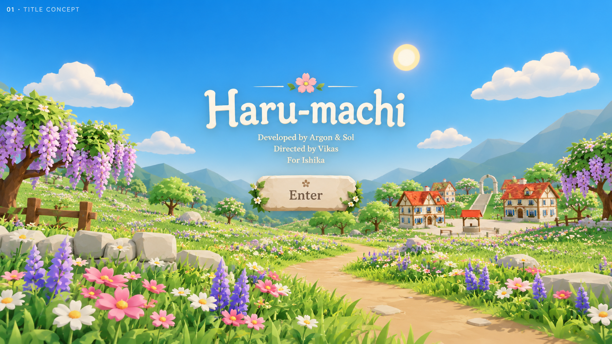
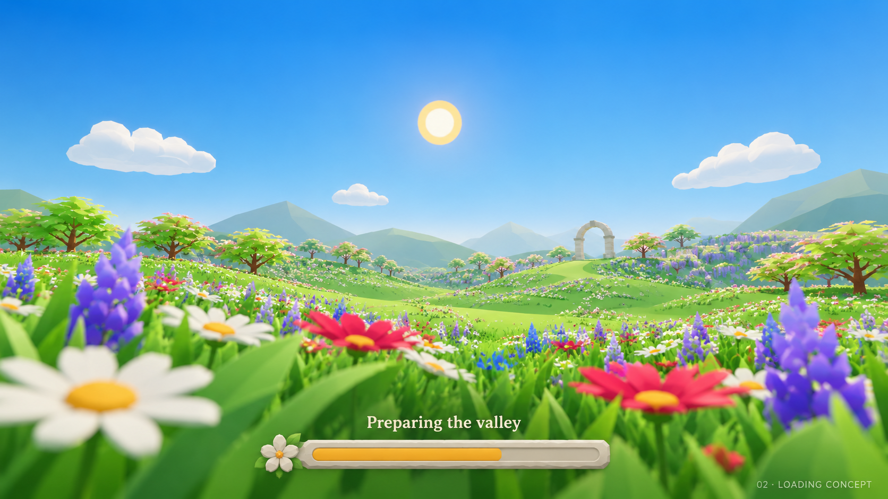
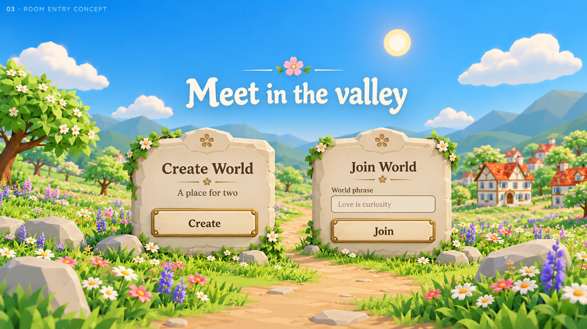
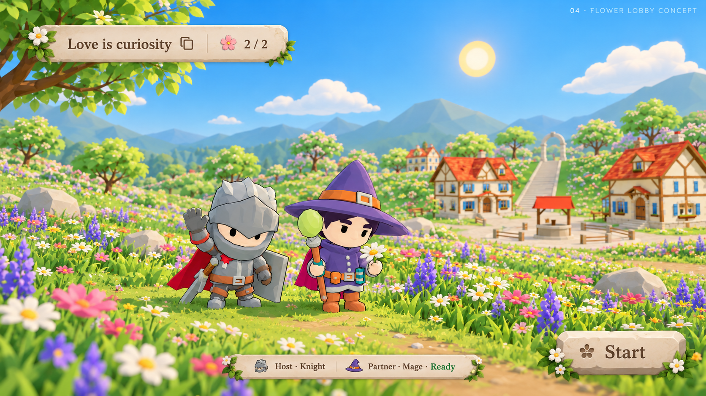
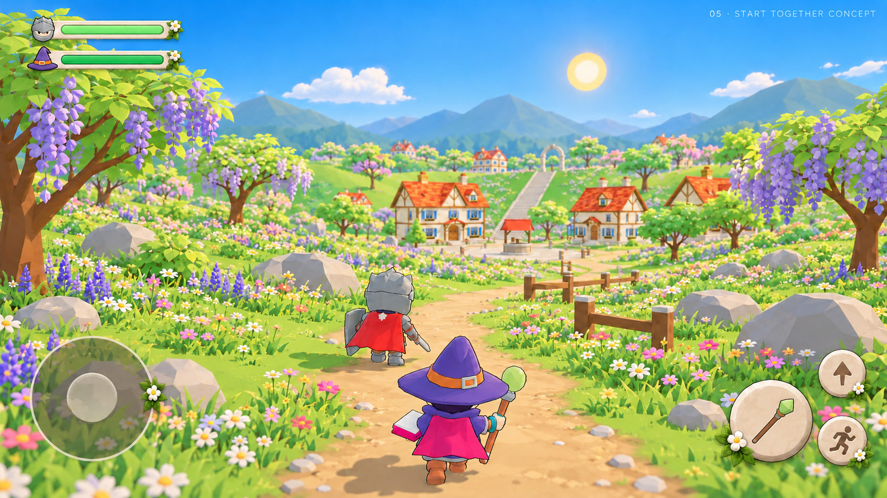
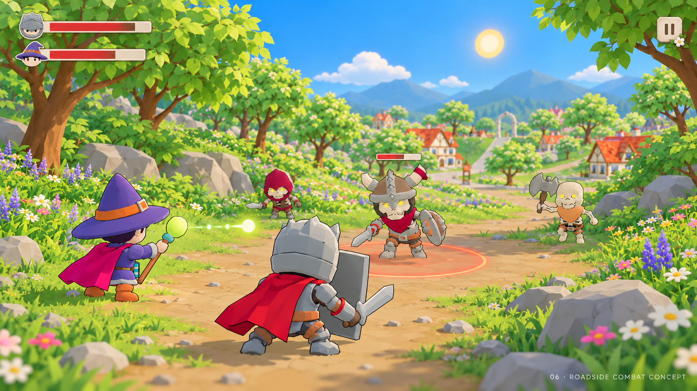
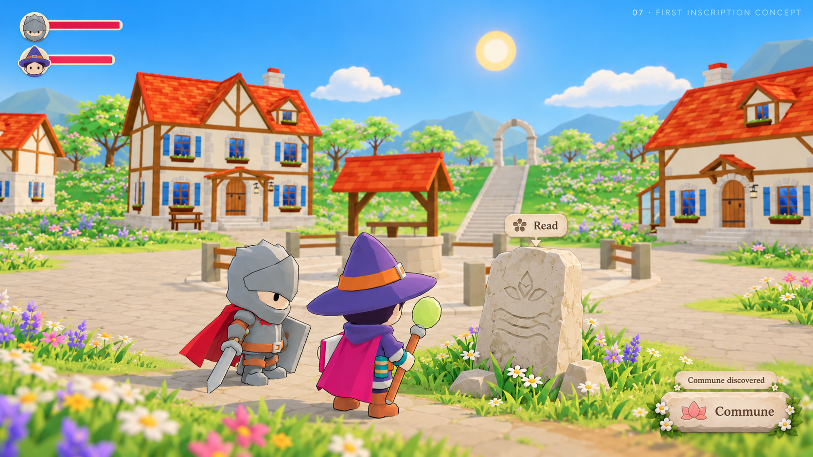
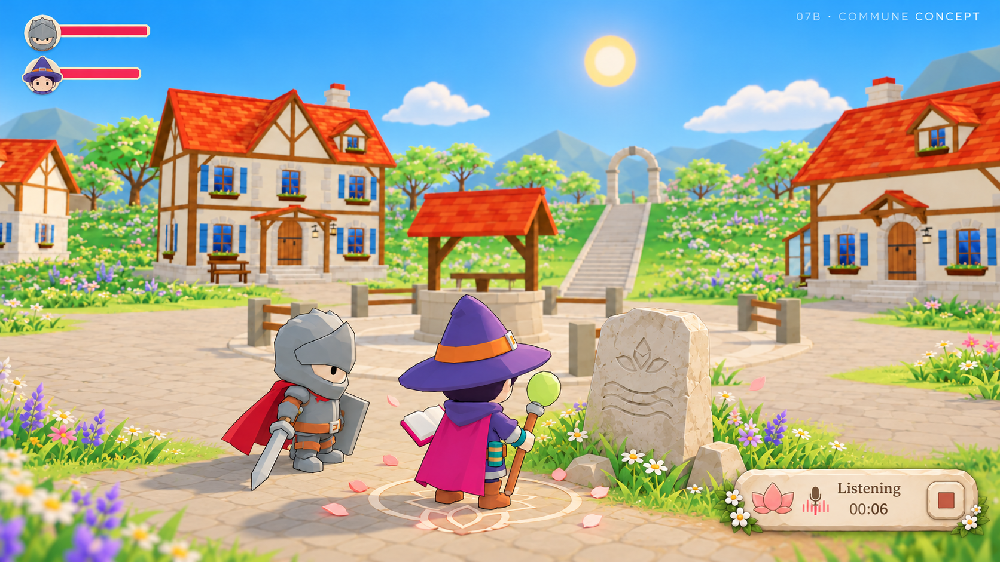
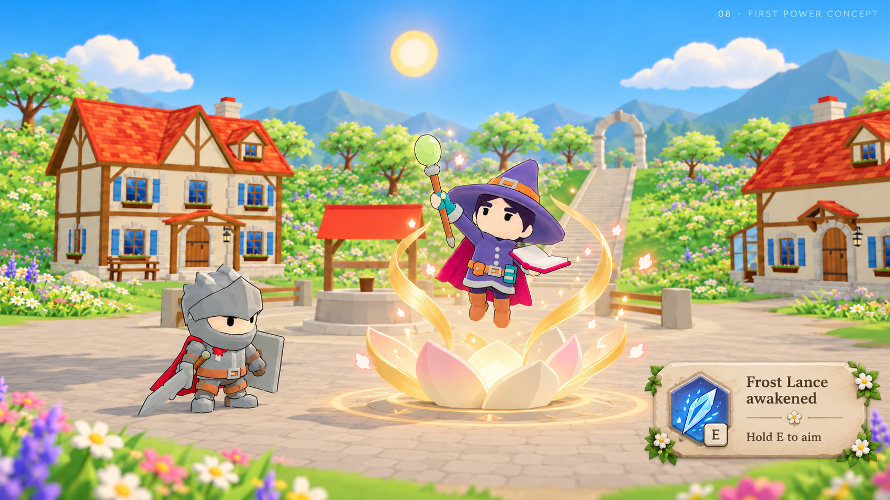

# Haru-machi: illustrated opening and discovery plan

Generated planning concepts only. No game changes. Built-in imagegen used with actual meadow, village, KayKit heroes and skeleton screenshots; some generations use the meadow concept for continuity. Images guide mood and layout, never literal geometry or verified animation.

Latest user correction: the red enemy ground circle and ordinary overhead enemy bars are rejected. Both Mage E spells use an adapted spellbook-style directional arrow. Ice range is fixed; meteor range follows the tip. The detailed production plan takes precedence over these rough pictures, including their slabs, ornament and inconsistent HUD styling.

## 1. Open the game

The flower field is the first thing you see. Title, your credits and one Enter button.

## 2. Prepare the valley

Load the actual assets. Show real progress; keep the screen calm.

## 3. Create or join

Create a two-person world, or enter the phrase / open an invite link. No account or character-selection menu.

## 4. Meet among the flowers

Random Knight/Mage assignment with fixed base stats. Gentle native emotes while waiting. Guest readies; host starts. This image is the host view.

## 5. The camera comes behind you

Start releases movement and combat controls for both players. Tablet gets joystick and touch actions. No powers cluttering the screen before they unlock.

## 6. Fight toward the town

Small skeleton encounters along a readable expanded approach. Learn attack, shielding and cooperation through play; the lobby field stays safe.

## 7. Discover an inscription

Reading any poem reveals Commune. Discover in any order, solve and unlock in sequence. Carvings in this concept are not the real poem.

## 8. Speak privately

Tap to record, tap to stop. Under 8 seconds: Retry, no submission. At 8–15 seconds: submit; at 15: stop automatically. Partner receives no audio or transcript.

## 9. Earn the next power

A brief awakening locks only the receiving character's inputs. The new ability appears with one useful hint; land, clear held inputs and return control. Frost Lance is an example reward, not a locked unlock order.

## Rules carried into production planning

- Max two players; room-wide random assignment produces exactly one Knight and one Mage with fixed base stats.
- Phrase and invite link join the same room. Guest Ready, host Start; both asset loads must finish. Disconnect clears readiness; reconnect preserves role.
- Flower waiting field is safe; gentle emotes must use available native skeletal clips. No claim that generated poses correspond to existing clips.
- Block out the added field and approach path before scenery; preserve landmarks, valley framing and boundary rule. Avoid empty walking and unbounded random spawns.
- Tablet gets touch controls; desktop hides learned movement buttons. Jump is secondary. No advanced powers before unlock.
- Poem discovery can be out of order; unlock sequence cannot. First poem reveals Commune. The pictured tablet contains no real verse.
- Only the god receives prayer audio. The partner gets neither recording nor transcript. One ceremony per pair. Under 8 seconds offers Retry without submission; 8–15 seconds submits on stop; 15 seconds stops/submits automatically. Failed/empty capture remains retryable.
- Ordinary prayer is modest; do not confuse it with emergency protection or full miracle cinematics.
- Power awakening briefly locks the receiving character's inputs, uses native pose/animation, clears queued/held inputs at exit and leaves the partner in control. New ability gets one compact hint.
- No artificial partner-proximity gate; actual casting range and physical shield coverage still matter.
- Unlocked powers and stronger encounters extend the loop toward lakeside/shrine and the current boss. Those later encounters, exact unlock order, reward balance, save/reset behavior and full emergency sequence need separate approval; these images illustrate the opening through the first example unlock.

## Image limitations noticed

- Generated environments are more polished and denser than current captures; this is not evidence of implemented asset quality or frame budgets.
- Health bars/frames/colors vary across scenes; final UI must use one consistent kit. These panels focus on flow.
- Mage attack icon in scene 5 was corrected using imagegen from a sword to a staff.
- Enemy silhouettes are references to the real skeleton pack; exact encounter composition remains to be authored.
- The reward shown is an example; Frost Lance is not being declared the mandatory first unlock.

Prompts are preserved in prompts.json. Original generated files remain under the image generator's default directory; selected copies are here in tmp for today. No deployment or automatic expiry is created by this storyboard task.

